# OpenCM4F, by Opus 5.5

An open **Cortex-M4F compatible processor** in Verilog: ARMv7E-M (Thumb-2, DSP extension) with the
FPv4-SP floating-point unit, an NVIC, SysTick and a DWT cycle counter, and two **AXI4-Lite** master
interfaces (instructions, data). It comes with cocotb testbenches that run the core in lockstep with
the Unicorn emulator, GTKWave views of the interesting signals, and a benchmark system for the
**Sipeed Tang Nano 20K** with a 480x272 LCD and a rotary encoder: pick CoreMark, Dhrystone,
Whetstone, FFT, a matrix product, a Q15 FIR, SHA-256 or CRC-32, run them, and compare the results
in charts.

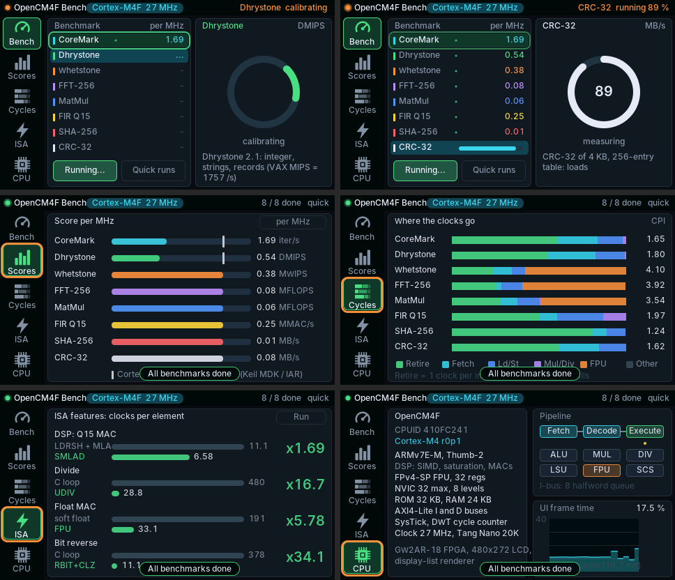

*The five pages of the benchmark application, captured from the LCD pins in the Verilator simulation of the whole SoC.*

At a glance (simulated SoC, quick runs; per MHz, the CPU clock is 27 MHz): CoreMark **1.69 /MHz**
(45.6 iterations/s, CRCs correct), Dhrystone 2.1 **0.54 DMIPS/MHz**, Whetstone 0.38 MWIPS/MHz;
the SoC uses 89 % of the GW2AR-18's logic and meets 27 MHz (CPU) / 54 MHz (renderer) with the
open-source flow. All benchmarks check their own results.

**Design document:** [docs/OpenCM4F_Design_and_Architecture.pdf](docs/OpenCM4F_Design_and_Architecture.pdf)
(47 pages, datasheet style): the system, the pipeline and every execution unit, the exception model,
the FPU, the renderer, the firmware, verification and implementation, with block diagrams and timing
diagrams cut from a simulation of the RTL. The drawings below come from it.

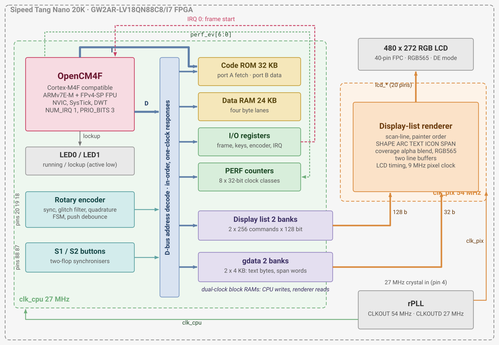

## What is in here

```
rtl/core/     the processor (no vendor primitives)
  opencm4f.v        top: AXI4-Lite I and D masters, IRQ / NMI / events, trace and performance outputs
  ocm4_core.v       pipeline control, execute stage, exceptions, special registers
  ocm4_fetch.v      AXI4-Lite instruction fetch, 8-halfword queue, 2 reads in flight
  ocm4_decode.v     Thumb / Thumb-2 / DSP / VFP decoder (one micro-op per clock)
  ocm4_regfile.v    register files (LUT RAM)
  ocm4_alu.v        ALU and barrel shifter        ocm4_bitops.v  bit field, SIMD, saturation, CLZ, RBIT, ...
  ocm4_mul.v        all multiplies, 2 clocks      ocm4_div.v     SDIV / UDIV, 2 bits per clock
  ocm4_lsu.v        load / store unit, AXI4-Lite D master, unaligned accesses, exclusive monitor
  ocm4_scs.v        System Control Space: NVIC, SCB, SysTick, DWT, FPU control, CoreDebug DEMCR
  ocm4_fpu.v        FPv4-SP: IEEE-754 single precision, bit-exact (DN, FZ, AHP, rounding modes, flags)
rtl/soc/      the Tang Nano 20K system: SoC, renderer (from Sat Signal Lab), encoder, pins, constraints
fw/           benchmark firmware: UI, pages, benchmark runner, CoreMark, Dhrystone, kernels
sw/           C runtime and test programs for the core testbench (exc_test.c: exceptions)
tb/cocotb/    cocotb testbenches (run.py), Unicorn reference model (armref.py, harness.py)
tb/gtkw/      GTKWave views: fetch, AXI buses, pipeline, exceptions, FPU
tb/verilator/ tb_soc.cpp (whole SoC with the firmware and the LCD), tb_gpu.cpp (renderer vs C model)
host/         raster.c: C reference of the renderer, bit for bit
tools/        asset, ROM and wave-view generators, frame converter, area report
scripts/      run_pnr.sh (open-source bitstream), area.sh, clocks.py
docs/         design document (PDF), architecture notes, images
opencm4f_tangnano20k.gprj, impl/   Gowin EDA project
```

## The core

| | |
|---|---|
| ISA | ARMv7E-M Thumb / Thumb-2: all integer, DSP (SIMD add/sub, saturation, packing, 16x16 and 32x16 MACs, SMLAD..., USAD8, SEL), bit-field, CLZ/RBIT/REV, SDIV/UDIV, LDREX/STREX/CLREX, IT blocks, TBB/TBH, CBZ/CBNZ, MRS/MSR, CPS, WFI/WFE/SEV, SVC, BKPT; FPv4-SP: VADD VSUB VMUL VNMUL VDIV VSQRT VMLA VMLS VNMLA VNMLS VFMA VFMS VFNMA VFNMS VABS VNEG VCMP(E) VCVT (int, fixed, half), VMOV (all forms), VLDR VSTR VLDM VSTM VPUSH VPOP VMRS VMSR |
| Pipeline | 3 stages: fetch (queue of 8 halfwords), decode + register read (with bypass), execute (multi-cycle units); branches resolve in execute |
| Buses | AXI4-Lite: I (read only, 2 reads in flight), D (posted writes, unaligned accesses split in two, byte strobes); in-order slaves; ARPROT/AWPROT give privilege and instruction / data |
| Exceptions | NVIC with 1..16 interrupts and 2..4 priority bits (priority grouping, BASEPRI, PRIMASK, FAULTMASK), NMI, SVCall, PendSV, SysTick, precise UsageFault / BusFault / HardFault (escalation, lockup), WFI / WFE / SEV, sleep-on-exit |
| Stacks / modes | MSP / PSP, Thread / Handler, privileged / unprivileged, 8-byte frame alignment (STKALIGN), EXC_RETURN, basic and extended (FP) frames, automatic FP context (FPCCR.ASPEN, FPDSCR); the FP registers are stacked eagerly: FPCCR.LSPEN is stored but not used, FPCAR is not loaded by hardware |
| System | SCB (CPUID 0x410FC241, ICSR, VTOR, AIRCR, SCR, CCR, SHPR, SHCSR, CFSR, HFSR, BFAR = MMFAR, ID registers, CPACR), SysTick, DWT CYCCNT, FPCCR / FPCAR / FPDSCR, MVFR0/1, ACTLR, DEMCR |
| Not implemented | MPU, halting debug (DAP, FPB, DWT comparators; a BKPT can halt the core via an input), ITM / ETM / TPIU, bit-banding, tail-chaining and late arrival (a pending exception is taken after the unstacking) |
| Latencies (clocks in execute, slave answering in one clock) | ALU 1, load 2, store 1 (posted), multiplies 2, SDIV / UDIV 2 + significant bits / 2, FP add / mul / FMA 10, VMLA (chained) 18, VDIV 21, VSQRT 20, VCVT 5..7, VCMP 4; a taken branch leaves 2 to 3 bubbles (resolved in execute) |
| Trace | one retired instruction per clock at most: PC, opcode, register / FP writes, xPSR, FPSCR, CONTROL (used by the lockstep testbench) |

### Inside the core

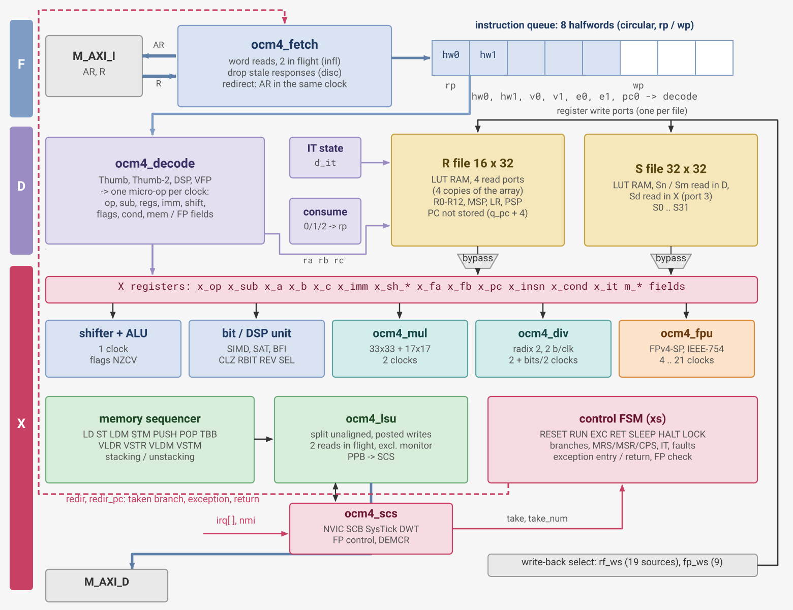

The fetch stage keeps an 8-halfword queue topped up with up to two word reads in flight. Decode turns
the first one or two halfwords into one micro-op and reads its operands from LUT-RAM register files
(one copy per read port), with bypass from the write port. Execute holds one micro-op at a time and
sequences the multi-clock work (loads and stores, LDM / STM, multiplies, divides, FP operations,
exception entry and return) with a step counter. Branches resolve in execute; the target goes out on
the instruction bus in the next clock.

Pipeline occupancy of a short test program, taken from an Icarus Verilog simulation of the RTL with a
zero-wait memory: ALU instructions retire one per clock, a store takes one clock (posted), the load after
it waits for the write response, the unaligned load is split into two reads, and the taken `beq`
leaves three empty clocks in execute:

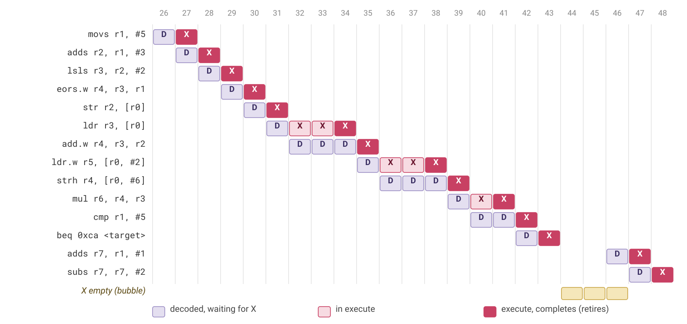

The same program on the AXI4-Lite data bus, and the taken branch on the instruction bus:

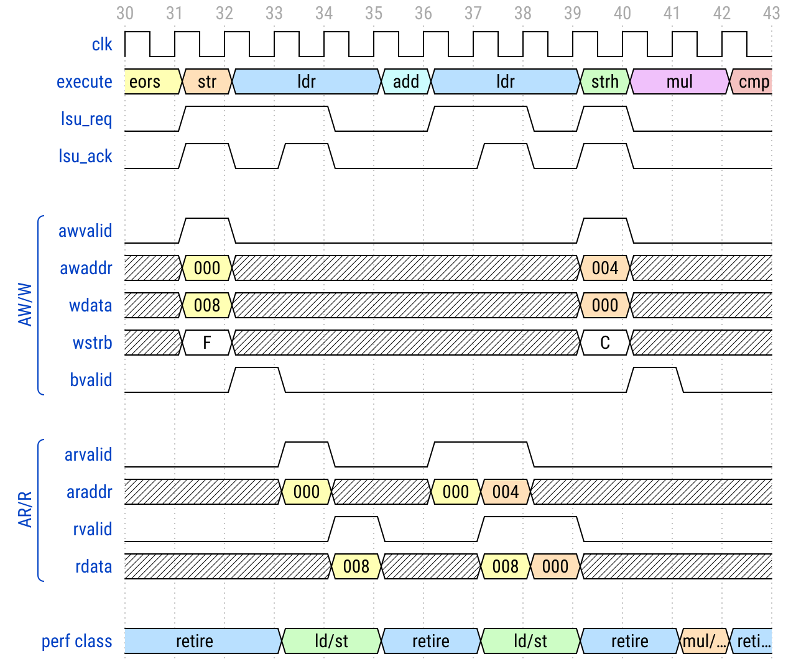

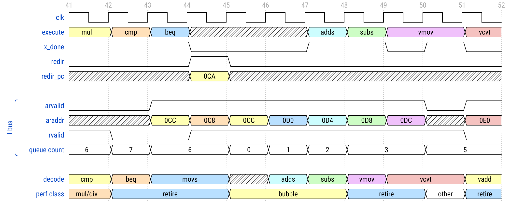

An interrupt taken from code that used the FPU writes the 26-word extended frame, one word per clock.
With a zero-wait memory, the handler's first instruction reaches execute 39 clocks after the IRQ line
rises. The return through `BX LR` takes 29 clocks.

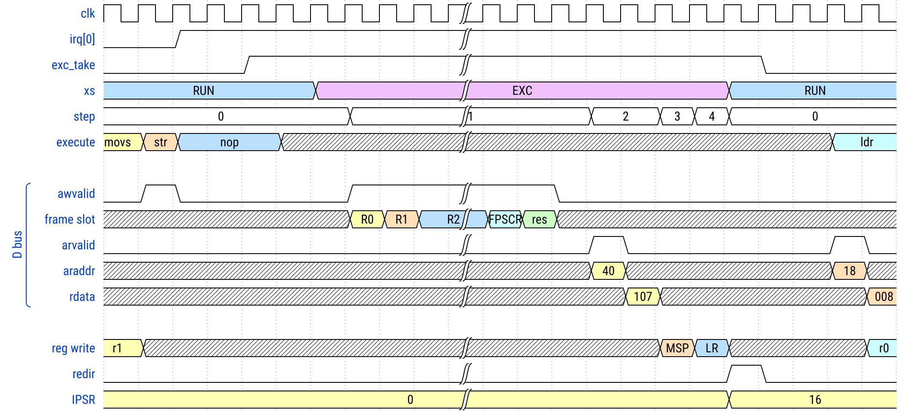

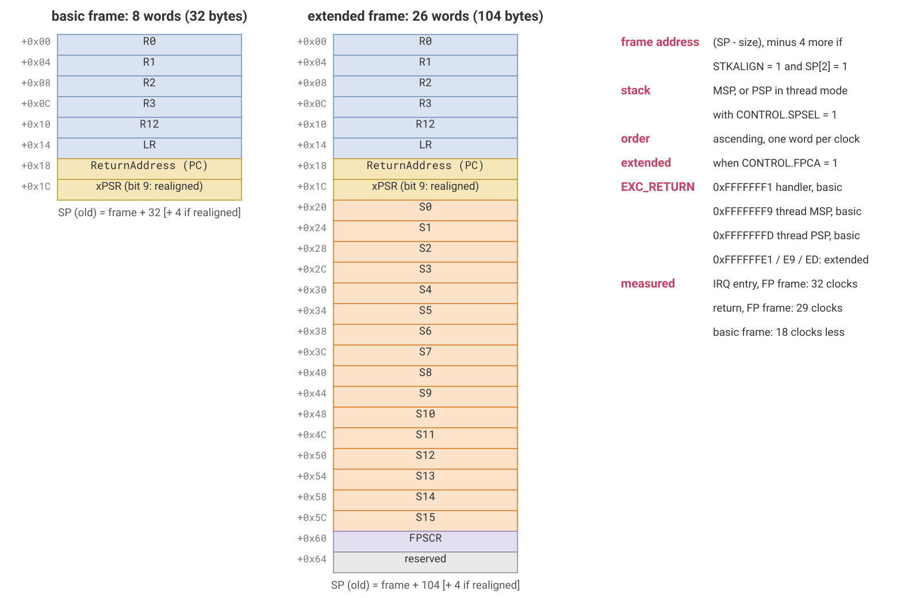 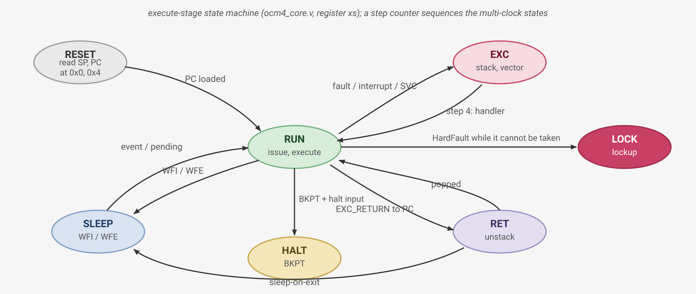

The FPU runs one operation at a time through a shared datapath: unpack, 24 x 24 product, alignment,
add, normalise and two rounding steps. Divide and square root are iterative, and the chained
multiply-accumulates run the datapath twice:

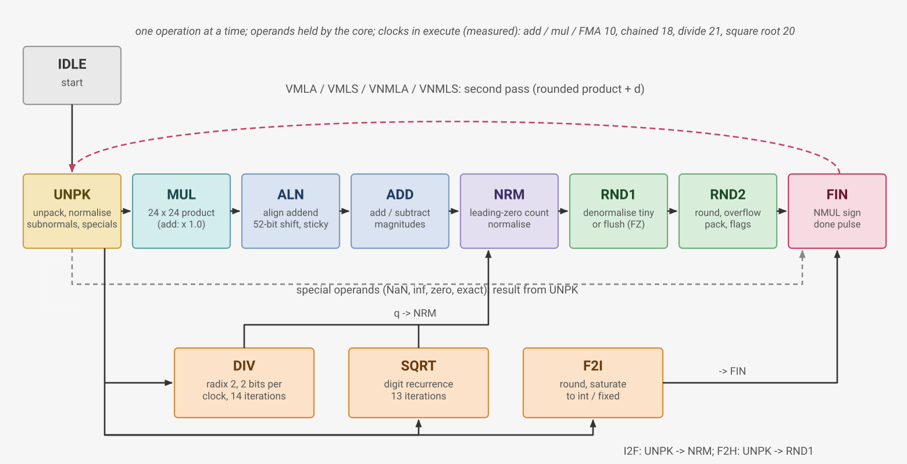

The core alone (yosys `synth_gowin`, NUM_IRQ = 1), area by unit; more in
[docs/architecture.md](docs/architecture.md) and the design document:

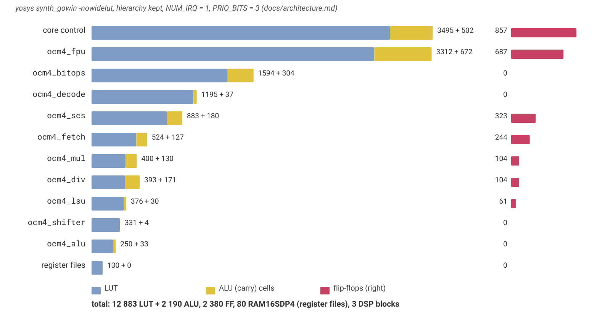

## Verification

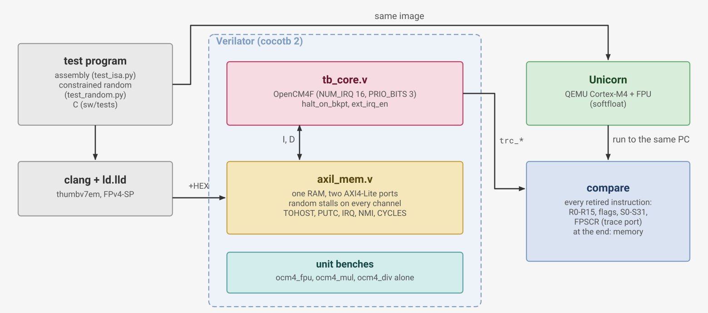

All benches use cocotb 2 with Verilator:

```
cd tb/cocotb
python3 run.py all                 # fpu mul div isa random programs
python3 run.py --waves isa         # + build/cocotb_isa_verilator/dump.fst for the GTKWave views
```

| bench | what | result |
|---|---|---|
| `fpu` | the FPU alone against Unicorn: every operation, all rounding modes, DN / FZ / AHP, NaNs, denormals, infinities, flags (FPU_VECTORS per operation) | 1 120 000 vectors (FPU_VECTORS=20000), 0 mismatches |
| `mul`, `div` | multiplier and divider against Python models of the pseudo-code: every multiply kind and flag combination, corner operands; SDIV / UDIV incl. /0 and INT_MIN / -1 | 20 000 each, 0 mismatches |
| `isa` | directed programs (ALU, shifts, bit fields, DSP, multiply / divide, loads / stores of every size and addressing mode, LDM / STM, branches, IT blocks, FP) run in lockstep with Unicorn: all registers, flags, FP registers and FPSCR compared after every instruction, with the AXI slaves stalling randomly | 10 groups pass |
| `random` | constrained-random programs (every instruction group, IT blocks, unaligned accesses, exclusives, FP) in lockstep with Unicorn, random bus stalls, memory compared at the end | 60 programs x 300 instructions (RANDOM_PROGRAMS=60), 0 mismatches |
| `programs` | C programs on the core: `sw/tests/exc_test.c` (51 checks: NVIC priorities and preemption, PendSV, SysTick, SVC, faults and escalation, BusFault / BFAR, UsageFaults, PSP / unprivileged threads, FP stacking, EXC_RETURN variants) | 51 / 51 |
| `tb_gpu` | the renderer against `host/raster.c` with random display lists of every command | 0 differing pixels |
| `tb_soc` | the whole SoC with the firmware: every LCD frame captured from the pins and compared line by line with the C rendering of the display list (a run of all benchmarks and a tour of the pages: 5.4 s, 312 frames) | 84 320 lines, 0 differ |

GTKWave views (open them with the dump):

```
gtkwave build/cocotb_isa_verilator/dump.fst tb/gtkw/pipeline.gtkw     # decode, execute, write-back, retire, LSU
gtkwave build/cocotb_isa_verilator/dump.fst tb/gtkw/fetch.gtkw        # I-bus and the halfword queue
gtkwave build/cocotb_isa_verilator/dump.fst tb/gtkw/axi.gtkw          # all AXI4-Lite channels
gtkwave build/cocotb_isa_verilator/dump.fst tb/gtkw/exceptions.gtkw   # NVIC, exception entry / return, faults
gtkwave build/cocotb_fpu_verilator/dump.fst tb/gtkw/fpu.gtkw          # FPU request, datapath states, result
```

(`python3 tools/gen_gtkw.py <isa dump> <fpu dump>` rewrites the views from a dump, so they follow RTL
changes. Recent Verilator versions need `liblz4-dev` for FST traces.)

## The Tang Nano 20K system

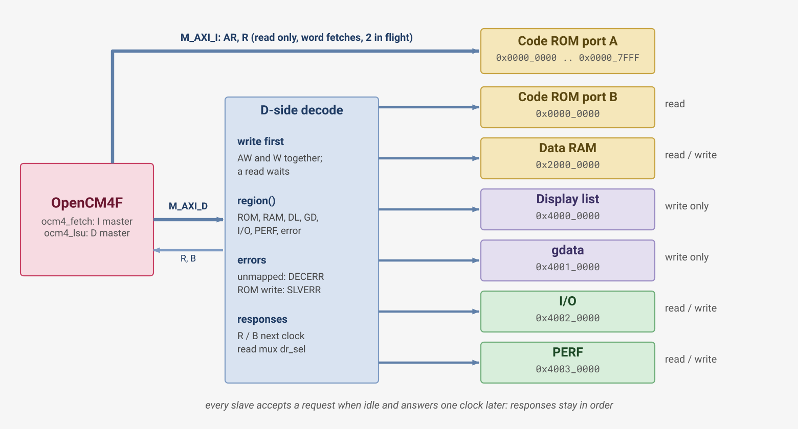

```
 27 MHz -> rPLL -> 54 MHz  clk_pix: renderer, LCD (9 MHz pixel clock)
                -> 27 MHz  clk_cpu: OpenCM4F, memories, I/O        (CLKOUTD = 54 / 2, edges aligned)

 OpenCM4F  M_AXI_I -----------------------> code ROM port A
           M_AXI_D --+-- 0x0000_0000  code ROM port B   32 KB  (firmware, read only)
                     +-- 0x2000_0000  data RAM          24 KB  (data, bss, stack)
                     +-- 0x4000_0000  display list      2 banks x 256 commands  -> renderer (dual-clock RAM)
                     +-- 0x4001_0000  gdata             2 banks x 4 KB          -> renderer (dual-clock RAM)
                     +-- 0x4002_0000  I/O: frame counter, buttons, bank, background, encoder, IRQ, clock
                     +-- 0x4003_0000  PERF: clock counters by class (retire, bubble, load/store, mul/div,
                                      FPU, exception, sleep, other)
           IRQ 0 <- frame start
```

Resources and timing of the whole system (open-source flow, `scripts/run_pnr.sh`):

| | used | of | |
|---|---:|---:|---|
| LUT4 positions (LUTs + ALU cells + LUT RAM) | 18 493 | 20 736 | 89 % |
| of which ALU (carry chains) | 3 526 | | |
| flip-flops | 3 914 | 15 552 | 25 % |
| RAM16SDP4 (register files, PERF counters) | 88 | 648 | |
| BSRAM (ROM 16, RAM 12, display list 4, gdata 4, renderer 8) | 44 | 46 | |
| DSP: MULT36X36 / MULT18X18 / MULT9X9 | 2 / 7 / 13 | 12 / 48 / 96 | |
| clk_cpu (OpenCM4F, memories, I/O) | 30.4 MHz max | 27 MHz | met |
| clk_pix (renderer, LCD) | 68.5 MHz max | 54 MHz | met |

The core alone is about 12.9 k LUTs + 2.2 k ALU cells, 2.4 k FFs, 80 RAM16SDP4 and 3 DSP blocks
(per unit in [docs/architecture.md](docs/architecture.md)). The CPU runs from the PLL's divided
output (CLKOUTD, 27 MHz, edges aligned with the 54 MHz renderer clock); the two domains meet only in
dual-clock block RAMs (display list, gdata) and two-flop synchronisers.

The display-list renderer draws each line from the list of commands in painter's order, one pixel per
clock, into one line buffer while the LCD shows the other. It has no frame buffer:

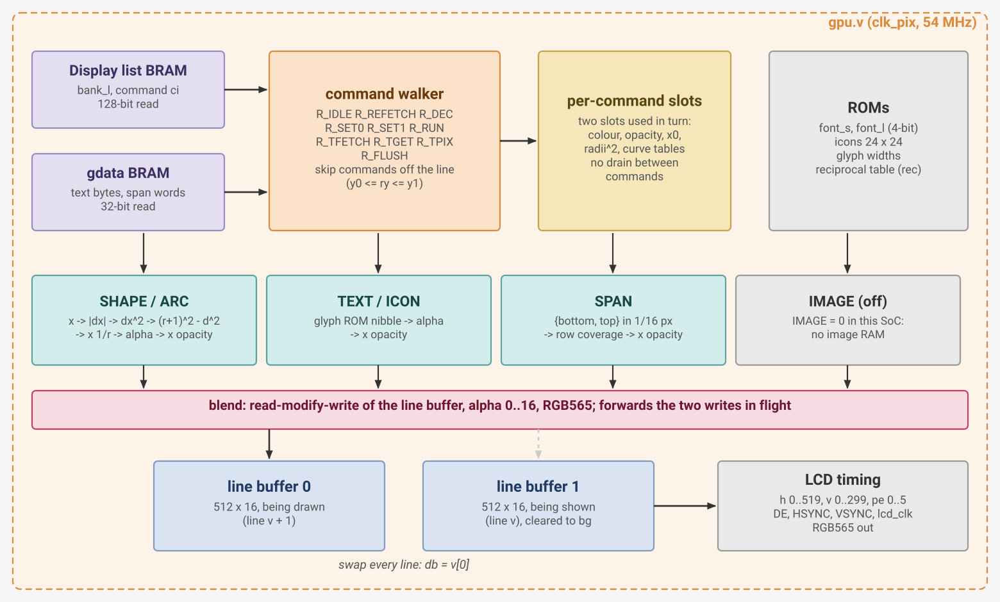

### Building

Firmware (clang / lld, no libc):

```
make -C fw           # fw/build/firmware.{elf,bin,lst,map} and rtl/soc/init_rom.vh (the ROM contents)
```

Bitstream with the open-source flow (yosys, nextpnr-himbaechel, apicula), as in `fpga_tools.md`:

```
scripts/run_pnr.sh build/pnr        # -> build/pnr/opencm4f.fs
openFPGALoader -b tangnano20k build/pnr/opencm4f.fs          # SRAM;  -f for the flash
```

Gowin EDA: open `opencm4f_tangnano20k.gprj` (top `tangnano20k_top`, include paths `rtl/core`,
`rtl/soc`, constraints `rtl/soc/tangnano20k.cst` and `rtl/soc/opencm4f.sdc`). The RTL uses no
vendor primitives except the rPLL in `tangnano20k_top.v`; the ROM contents come from
`rtl/soc/init_rom.vh` (rebuild the firmware first). A prebuilt bitstream is in `bitstream/`.

### Simulating the SoC

```
make -C fw sim SIMDEFS=-DSIM_RUN=9     # short runs, starts "Run all" at once
cd rtl/soc && verilator --cc --exe --build -O3 -Wno-fatal -Wno-WIDTH -Wno-lint -Wno-style --public-flat-rw \
  --top-module ocm4_soc -Mdir ../../build/tbsoc -I../core ocm4_soc.v gpu.v encoder.v ../core/*.v \
  ../../tb/verilator/tb_soc.cpp ../../host/raster.c -o tbsoc
../../build/tbsoc/tbsoc 60 frames.raw ../../tb/scripts/tour.txt 1 ../../fw/sim/firmware.bin
python3 ../../tools/frames.py frames.raw frame.png 59         # or frames.gif
```

The script file presses S1 / S2 and turns / pushes the encoder at given frames (see `tb_soc.cpp`).

## The benchmark application

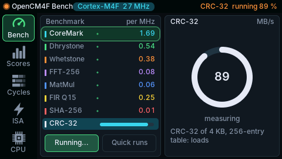

Controls: turn the encoder to move the green ring, push to act; hold the push 0.5 s to get to the page
tabs (turn to pick a page, push to use it). S1 = next control (hold: next page), S2 = act.

| page | |
|---|---|
| **Bench** | the eight benchmarks: push one to run it, or *Run all*; *Quick / Full runs*. The right card shows the selected result: score at the clock and per MHz, the published Cortex-M4 figure where there is one, a donut of where the clocks went, CPI, and whether the results checked out. While a benchmark runs, its progress ring fills |
| **Scores** | bullet chart: every score per MHz (or absolute) on its own scale, with the Cortex-M4 reference tick |
| **Cycles** | 100 % stacked bars of the clock classes per benchmark (retire, fetch / branch bubbles, load / store, multiply / divide, FPU, other) and the CPI |
| **ISA** | what the ARMv7E-M features buy: the same work without and with SMLAD, UDIV, the FPU, RBIT + CLZ, in clocks per element, and the speed-up |
| **CPU** | what the core reports about itself (CPUID, ID registers, NVIC), a pipeline diagram, and a live chart of the clocks the UI needs per frame |

How the measurements work: the SoC counts every CPU clock in one of eight classes. A benchmark is
calibrated (units doubled until it takes 2 M clocks), then run for 2 s (CoreMark: 11 s, so that it
is a valid CoreMark run; *Quick*: 0.25 s / 1 s). The UI keeps drawing from the frame interrupt
while a benchmark runs: the handler stops the counters on entry and restarts them on return, and
the exception entry / return clocks are not counted, so the scores do not depend on the UI. Every
benchmark checks its results (CoreMark's CRCs, Dhrystone's final values, Whetstone's results, FFT
bins, exact matrix products, FIR against a plain C version, SHA-256 and CRC-32 digests).

### Results

Measured in the Verilator simulation of the whole SoC (the same RTL and firmware as the bitstream),
*Quick* runs, everything validated:

| benchmark | per MHz | at 27 MHz | CPI | where the clocks go (main stalls) | Cortex-M4 (ARM) |
|---|---:|---:|---:|---|---:|
| CoreMark 1.0 (`-O2 -fno-unroll-loops`) | 1.69 | 45.6 iter/s | 1.65 | fetch / branch bubbles, loads | 3.40 |
| Dhrystone 2.1 (no inlining) | 0.54 DMIPS | 14.6 DMIPS | 1.80 | fetch / branch bubbles, loads | 1.25 |
| Whetstone, single precision | 0.38 MWIPS | 10.3 MWIPS | 4.10 | FPU | |
| FFT-256 complex float | 0.08 MFLOPS | 2.2 MFLOPS | 3.92 | FPU | |
| MatMul 16 x 16 float | 0.06 MFLOPS | 1.6 MFLOPS | 3.54 | FPU, loads | |
| FIR Q15, 32 taps (SMLAD) | 0.25 MMAC/s | 6.8 MMAC/s | 1.97 | loads (unaligned pairs), MAC | |
| SHA-256 | 0.01 MB/s | 0.3 MB/s | 1.24 | | |
| CRC-32 (table) | 0.08 MB/s | 2.2 MB/s | 1.62 | loads | |

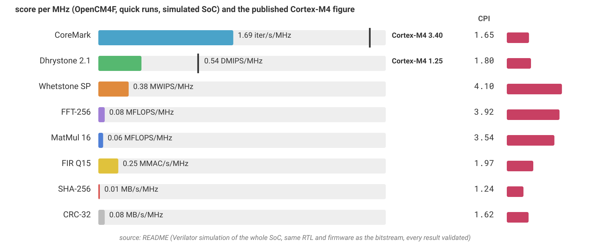

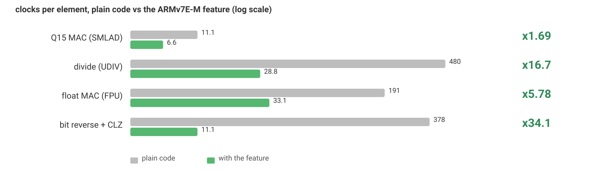

ISA page (clocks per element, plain code / with the feature): Q15 MAC 11.1 / 6.6 (SMLAD, x1.7),
divide 480 / 28.8 (UDIV, x16.7), float multiply-add 191 / 33.1 (FPU vs soft float, x5.8), bit
reverse + leading zeros 378 / 11.1 (RBIT + CLZ, x34).

Why about half a Cortex-M4 per MHz: loads take two clocks in execute (the M4 pipelines them), a
taken branch costs two to three clocks of fetch bubbles (no prediction, branches resolve in
execute), and FP add / multiply take 10 clocks (1 on the M4). The *Cycles* page shows this per
benchmark. In full mode the runs last 2 s (CoreMark 11 s, a valid CoreMark run); the per-MHz
numbers do not change with the run length.

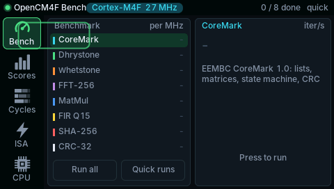

## Licence

MIT for everything written for this project (SPDX headers). CoreMark (`fw/coremark/`, EEMBC, Apache
2.0, unmodified except the port files), Dhrystone (`fw/dhry/`, from riscv-tests, BSD), the Inter font
(SIL OFL, rendered into the font ROMs).
